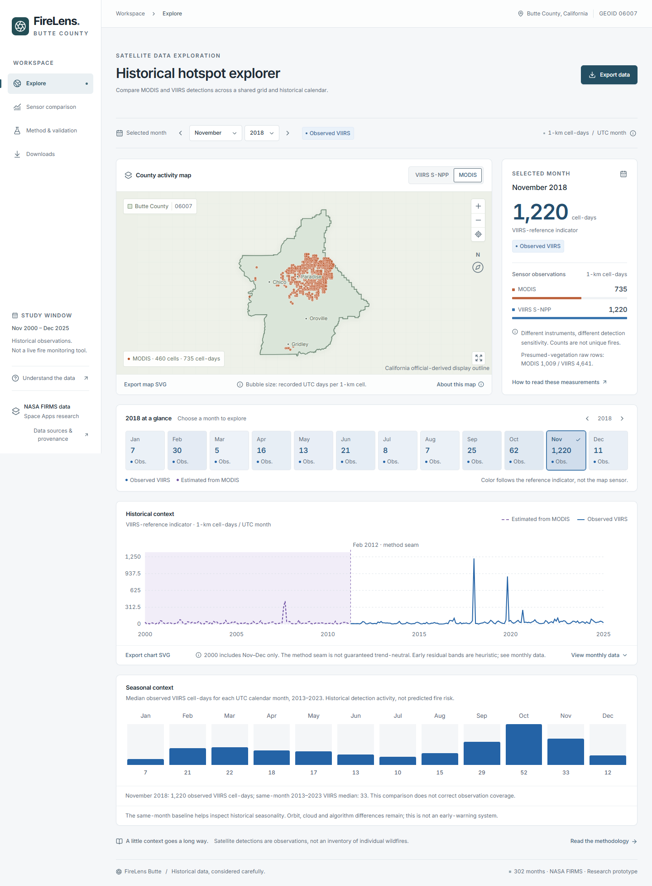
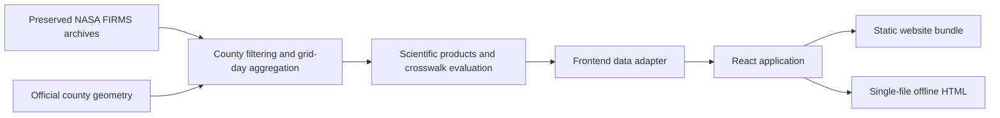

# FireLens Butte — Historical Satellite Hotspot Explorer

**NASA Space Apps Challenge 2026 · Harmonization of MODIS and VIIRS Hot Spots**

FireLens compares historical NASA FIRMS MODIS and VIIRS hotspot observations in **Butte County, California (GEOID 06007)** through a calendar, map, and downloadable evidence. We show sensor differences and label early estimates so visitors can inspect hotspot activity without mistaking it for a count of unique wildfires.

**Explore the project:** [six-slide demo PDF — draft; team identities pending](https://raw.githubusercontent.com/bilalfarid-1/firelens/main/docs/demo/FireLens_Demo_6_Slides.pdf) · [source repository](https://github.com/bilalfarid-1/firelens) · [scientific method](docs/scientific_method.md) · [validation evidence](evidence/independent_results.json)



To try the application, [download the static release ZIP](https://github.com/bilalfarid-1/firelens/raw/refs/heads/main/release/FireLens_Butte_Static_Site.zip) and serve its contents, or clone the repository and open `release/FireLens_Butte_Offline.html` in your browser. No installation is needed for the offline version.

> **Release status:** Tested release candidate under team review. Historical Activity Insight was integrated on 15 November 2026; see the [integration report](audit/PR1_INTEGRATION.md) for current checks. The source and demo draft are public. Website deployment and NASA submission were not performed by this integration. The demo remains **CONTENT PENDING OWNER**. This project is not NASA-approved or an operational fire-warning service.

## The problem and our approach

MODIS and VIIRS differ in pixel size, detection sensitivity, overpass timing, confidence fields, and observation coverage. Combining their raw CSV rows would mix these differences with changes in detected activity.

We keep both observation series visible and use one explicit comparison unit: an **occupied 1-km cell-day**. If a sensor detects activity in the same grid cell five times on one UTC day, that contributes one cell-day. Detecting activity in that cell on another day contributes another. This reduces same-day multiplicity without treating detections as separate fire incidents.

Butte County gives us a bounded study area with an official polygon, manageable archives, and a scope we could check carefully. It is our implementation choice, not a NASA-mandated region or evidence that the method transfers elsewhere.

For earlier history, we use an exploratory MODIS-to-VIIRS statistical crosswalk. The calendar distinguishes **MODIS-based estimates before February 2012** from **observed VIIRS from February 2012 onward**. January 2012 is treated as a partial-coverage transition month. A shared grid makes the comparison explicit; it does not make the sensors equivalent.

## What you can explore

- **Historical calendar:** Select months from November 2000 through December 2025 and inspect observed or estimated values.
- **County activity map:** Switch between observed sensor aggregations, zoom, reset or expand the map, and inspect a cell table.
- **Sensor comparisons:** Compare monthly measurements, history charts, and historical seasonal medians.
- **Historical activity insight:** Compare an observed month with other same-calendar-month VIIRS observations in 2013–2023, excluding the selected year. See the comparison median/maximum and an explicitly exploratory elevated-activity category; coverage warnings remain visible.
- **Method and validation:** Inspect model evaluation, simpler baselines, provenance, and coverage warnings.
- **Downloads:** Export monthly ranges, full data products, and SVG maps or charts.
- **Offline application:** Use the bundled HTML with local data, fonts, and styles, without a live API or external map service.

## Data and methodology

Our preserved inputs are NASA FIRMS **MODIS Terra/Aqua** request `848030` and **VIIRS Suomi NPP** request `848031`. The release calendar spans November 2000–December 2025; this does not imply both sensors observed the entire period.

| Product or check | MODIS | VIIRS S-NPP |
|---|---:|---:|
| County source detections | 7,211 | 16,526 |
| Retained source `type=0` detections | 7,105 | 16,450 |
| November 2018 occupied cell-days | 735 | 1,220 |
| July 2024 occupied cell-days | 322 | 58 |

We filter detection centers to the county, retain source `type=0` presumed-vegetation detections, and preserve both day/night observations and native confidence fields. Coordinates are projected into **EPSG:3310 (California Albers)** and assigned to a fixed 1-km grid. Unique sensor/cell/UTC-date combinations are summed within each month.

The products contain **302 historical months** and **7,543 observed grid-month rows**. An independent full-resolution polygon replay matched the original county rows exactly, including ordering and multiplicity. All **604 monthly sensor comparisons** matched the independently recomputed aggregation. The application uses a simplified outline for display; that outline is distinct from the full polygon used to verify membership.

The crosswalk fits a robust regression on `log1p` monthly counts using **2013–2023: 132 training months**. Model candidates were compared using leave-entire-year-out validation within that period. **2024–2025: 24 months** are held out in the inspected implementation. Development-time isolation before the handover cannot be established from the source snapshot alone.

Details: [scientific method](docs/scientific_method.md), [independent audit update](docs/INDEPENDENT_AUDIT_UPDATE.md), and [machine-readable results](evidence/independent_results.json).

## Results and scientific limits

These errors measure agreement with an imperfect VIIRS reference, **not accuracy against known wildfire activity**.

| Method | Held-out MAE, cell-days/month ↓ |
|---|---:|
| Training calendar-month median | 18.96 |
| Overall training median | 19.63 |
| MODIS-to-VIIRS crosswalk | 20.33 |
| Unadjusted MODIS | 32.00 |

The crosswalk improves on unadjusted MODIS for this comparison, but the median baselines have lower MAE. We do not claim universal model superiority.

July 2024 illustrates the coverage problem: MODIS reports **322** cell-days and VIIRS **58**. Documented S-NPP outages overlap this period. We retain the month and its warning; we cannot infer how many detections were missed or attribute the whole discrepancy to the outage.

Other material limits remain:

- VIIRS is **not wildfire ground truth**, and detection files do not establish complete observation coverage.
- Early MODIS-based estimates are unvalidated backward transfers. A zero MODIS count can still yield a positive estimate.
- Displayed residual bands are heuristic, not calibrated confidence intervals.
- Early Terra-only coverage and the 2012 observed/estimated transition can affect historical comparisons.
- Mixed MODIS version strings `6.03` and `61.03` leave a provenance question unresolved; we do not claim uniformly confirmed C6.1 inputs.
- The release covers one county and ends in December 2025. It does not estimate burned area, count unique wildfires, or predict future fires.

See [assumptions and limitations](docs/assumptions_and_limits.md).

## Technical architecture

Python, NumPy, pandas, SciPy, Shapely, PyProj, and Matplotlib support processing and analysis. React, TypeScript, Vite, Tailwind CSS, and SVG provide the interface. Precomputed products are bundled into the release; the frontend does not fit models or query NASA at runtime.



## Getting started on Windows

### Open the existing release

With Git installed, run these commands in PowerShell:

```powershell
git clone https://github.com/bilalfarid-1/firelens.git
Set-Location firelens
Start-Process .\release\FireLens_Butte_Offline.html
```

Alternatively, with Python installed, serve the prebuilt site:

```powershell
python -m http.server 8000 --bind 127.0.0.1 --directory release/site
```

Open [localhost:8000](http://localhost:8000/). Press `Ctrl+C` in the terminal to stop the server. Node.js is unnecessary for either prebuilt option.

### Set up development dependencies

The documented release environment uses **Python 3.12+ and Node.js 24**, with npm. From the cloned repository root:

```powershell
python -m venv .venv
.\.venv\Scripts\python.exe -m pip install -r requirements.txt -r requirements_harmonization.txt
.\.venv\Scripts\python.exe pipeline/prepare_frontend.py
Push-Location frontend
npm ci
npm run dev
```

Open [localhost:5173](http://localhost:5173/). When finished, press `Ctrl+C`, then run `Pop-Location` to return to the repository root. Using the virtual environment's Python directly avoids PowerShell activation-policy changes. Dependency installation requires internet access; the packaged application runs offline afterward.

### Run tests and rebuild when needed

From the repository root, after installing dependencies:

```powershell
.\.venv\Scripts\python.exe -m unittest discover -s tests -v
.\.venv\Scripts\python.exe pipeline/prepare_frontend.py
Push-Location frontend
npm run typecheck
npm test
npm run build
Pop-Location
.\.venv\Scripts\python.exe pipeline/package_site.py
```

The adapter reads existing scientific products. Vite builds the frontend, and the packaging script refreshes `release/site/`, `release/FireLens_Butte_Offline.html`, and the release manifest. It does **not** regenerate the distributable ZIP archives.

Scientific regeneration is a separate operation: `pipeline/harmonize.py` and `pipeline/sensitivity.py` write derived products. Preserve the original archives and county CSVs, use a separate working copy for experiments, and consult the methodology before regenerating results. `pipeline/build_offline.py` packages the earlier `web/` interface, not the current React application.

## Repository structure

```text
firelens/
├── frontend/                 React application, generated data, frontend tests
├── pipeline/                 Scientific processing, data adapter, site packaging
├── results/                  Preserved county inputs and source manifests
├── results_exact_replay/     Full-polygon replay outputs
├── products/                 Monthly/yearly indicators, grid and validation CSVs
├── tests/                    Python integrity and regression checks
├── evidence/                 Scientific results, browser logs and screenshots
├── docs/                     Methods, limitations, demo, credits and owner actions
├── audit/                    Release and correction reports
├── release/                  Static site, offline HTML and packaged archives
├── web/                      Earlier MVP, retained for pipeline reproducibility
├── .github/workflows/        Manual Pages deployment workflow
├── process_butte_county.py   Reproducible county extraction
├── DL_FIRE_M-C61_848030.zip  Preserved MODIS source archive
└── DL_FIRE_SV-C2_848031.zip   Preserved VIIRS source archive
```

## Recorded testing and verification

The following historical results were recorded during the 14 November 2026 release work. They were not rerun for the earlier README-only update. They describe the verified application carried into commit `421ec75`, not any later changes. When the team changes the application or release, update the release status and evidence links after running the affected checks; a newer README date does not extend these results.

| Verification | Recorded result | Evidence |
|---|---|---|
| Python unit/regression tests | 12 passed | [Python test log](evidence/corrections/python-tests.log) |
| Frontend data tests | 4 passed | [Frontend test log](evidence/corrections/frontend-tests.log) |
| Full Windows Edge acceptance gate | 39 hosted + 39 offline checks passed | [Browser summary](evidence/final/browser_summary.json) |
| Additional Chrome smoke test | 4 checks passed | [Chrome log](evidence/final/chrome-smoke.log) |
| Later documentation-correction smoke test | 7 checks passed | [Correction smoke log](evidence/corrections/browser-smoke.log) |

Release checks also compared exported CSV rows with canonical products, parsed SVG exports, and verified protected source hashes. No external runtime requests or JavaScript exceptions were observed in the full browser gate. Keyboard and selected contrast checks are recorded, but do not constitute complete WCAG or screen-reader certification. Passing software tests does not establish scientific ground-truth accuracy.

See the [release audit](audit/FINAL_RELEASE_AUDIT.md), [correction report](audit/FINAL_CORRECTIONS_REPORT.md), and [protected hashes](evidence/corrections/protected_before.json).

The Historical Activity Insight integration is documented separately in [the integration report](audit/PR1_INTEGRATION.md), with its new test and release results. Its reference window excludes the selected year; the existing Seasonal context panel retains the full fixed-period baseline. Neither comparison is a forecast or significance test.

## Team, credits and AI assistance

Our team has five registered members and three reported active contributors, as reported by our coordinator. We are preparing FireLens for NASA Space Apps 2026. Verified identities and individual contributions remain for the team to confirm; we do not infer them from Git's configured author name.

ChatGPT/Codex substantially assisted processing and application code, design translation, source inspection, testing, exports, documentation, and demo preparation. We supplied a Figma Make-derived prototype and an AQI Predictor interface reference. Their use is documented; ownership and reuse rights still require confirmation. NASA's original observations were not AI-generated. The team remains responsible for final scientific claims, idea-origin declarations, review, and submission.

[MuhammadSaif700](https://github.com/MuhammadSaif700) contributed Historical Activity Insight through [PR #1](https://github.com/bilalfarid-1/firelens/pull/1); the original commit is retained. See the [feature notes](docs/HISTORICAL_ACTIVITY_FEATURE.md) for its comparison rules and limits.

We credit NASA FIRMS for observations, California's official county source for geometry, and the authors of React/ReactDOM, Lucide, Inter, and the scientific/build dependencies. See [credits and AI assistance](docs/CREDITS_AND_AI_ASSISTANCE.md) and the [dependency inventory](evidence/final/npm_dependency_inventory.json).

## Project status and next steps

The local application, scientific products, exports, and source release are available for review. Before official submission, we still need to:

1. Confirm team identity, accepted roster, registered event, and eligibility in the actual NASA portal.
2. Review the genuine idea/development chronology and make truthful originality and SI declarations.
3. Confirm remaining prototype, asset, and source rights; the MIT license for team-owned original code is approved.
4. Fill the demo's identity placeholders and approve its final content.
5. Verify the controlling deadline, complete the NASA form, and explicitly authorize **Submit for Judging**; saving a draft is insufficient.

GitHub Pages is optional. A [manual deployment workflow](.github/workflows/pages.yml) is prepared, but website publication requires separate authorization and public verification. We provide no unverified live-app URL here.

Current handoff: [owner checklist](docs/OWNER_ACTIONS.md), [submission draft](docs/SUBMISSION_READY.md), [compliance matrix](docs/FINAL_NASA_COMPLIANCE.md), and [hosting instructions](docs/GITHUB_HOSTING.md). These are project records, not a guarantee of eligibility or judging approval.

## License

Our team-owned original source code and associated documentation are licensed under the [MIT License](LICENSE), with the notice `Copyright (c) 2026 FireLens Butte contributors`.

This license does not claim ownership of or relicense NASA FIRMS datasets, California geographic data, third-party dependencies, fonts, icons, or prototype/other assets. Their applicable terms and existing [third-party notices](frontend/public/licenses/) remain separate. Prototype and other unresolved reuse permissions are recorded in the [rights inventory](docs/RIGHTS_INVENTORY.md).

## References

- [Official NASA challenge](https://www.spaceappschallenge.org/2026/challenges/modis-and-viirs-hot-spots/)
- [NASA Earthdata FIRMS](https://www.earthdata.nasa.gov/data/tools/firms)
- [MODIS fire/hotspot attributes](https://firms.modaps.eosdis.nasa.gov/content/descriptions/FIRMS_MODIS_Firehotspots.html)
- [VIIRS fire/hotspot attributes](https://firms.modaps.eosdis.nasa.gov/content/descriptions/FIRMS_VIIRS_Firehotspots.html)
- [NASA MODAPS S-NPP outage records](https://modaps.modaps.eosdis.nasa.gov/services/production/outages_suomi_npp.html)
- [California county boundaries and identifiers](https://publish.data.ca.gov/dataset/california-county-boundaries-and-identifiers)
- [Project source references](docs/references.md)
